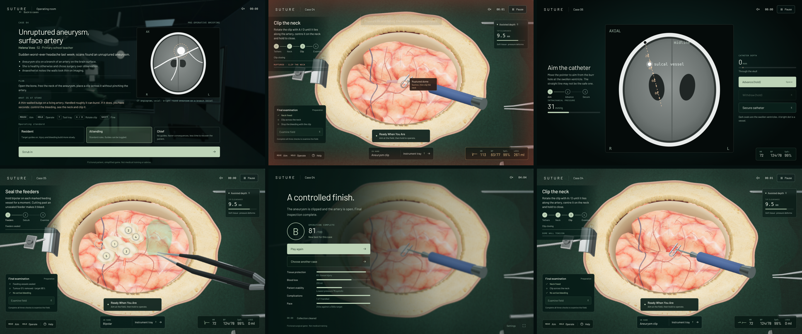

# Suture

**A browser neurosurgery game.** Read the patient's briefing, scrub in, and keep a steady hand through six different procedures. The patient has a heartbeat, blood pressure and an anaesthetist who talks to you. Your choices change what happens next, and every operation ends with a graded debrief.

**Play online: https://losttnt.github.io/Surgery-Simulator/**



> Suture is a game. Its patients are fictional and its procedures are simplified. It is **not** medical training, medical advice or a clinical simulator.

## The 60-second pitch

Most surgery games are one loop with different skins. Suture's cases play differently from each other:

| Case | What you do | The tense part |
| --- | --- | --- |
| **Lab** | Learn the burr, suction, irrigation and bipolar on a practice field. | Nothing is at risk. |
| **01 · Chronic subdural** | Open the bone, drain an old collection, rinse. | At Attending level the membrane tears; the patient is on a blood thinner. |
| **02 · Acute bleed** | Find and coagulate the marked source before you do anything else. | A second vessel was hiding under the clot. |
| **03 · Loculated washout** | Clear six walled-off pockets, then wash out. | A wall between pockets gives way and one refills. |
| **04 · Aneurysm clipping** | Release two tethers, free the neck, align and close a clip. | Rough handling raises dome tension. If it ruptures you must suction to see, then clip fast, or the patient crashes. |
| **05 · Tumour resection** | Seal feeding vessels, then debulk to at least 85%. | A green motor-cortex zone. Touch it and the patient's hand pays. Cut past an unsealed feeder and it bleeds. |
| **06 · Ventricular drain** | Aim a catheter on a CT slice at a swollen ventricle. | Pressure is climbing. The obvious straight line clips a vessel, so you have to angle around it. |

Each case opens with a short, quiet **arrival scene** in an eerily empty hospital at night, then plays with sound on by default: a failing fluorescent hum, a ventilator, the monitor, wet suction, and spoken anaesthetist callouts. Every case has a **patient briefing with a scan**, three **operating standards** (Resident, Attending, Chief), a **live monitor** (HR, BP, SpO₂, blood loss) driven by what you do, **anaesthetist callouts**, and a **graded debrief** (S to F) covering tissue protection, blood loss, stability, complications handled, and pace or extent of resection. The debrief ends with a one-line human outcome (who woke up, who did not) and surgeon's notes that explain what went wrong. Blood spurts with the heartbeat and pools on the field, injuries leave bruises, vision fades as pressure falls, and a long operation slowly wears the patient down.

## Controls

| Input | Action |
| --- | --- |
| Mouse | Aim the instrument |
| Hold left button | Operate the held instrument |
| `T` | Open the instrument tray (one tool in hand at a time) |
| Scroll | Trim tool depth (assisted mode) |
| `Shift` | Fine movement |
| `Q` | Toggle manual depth (full shaft contact) |
| `A` / `D` | Rotate the aneurysm clip (Case 04) |
| `Space` / `R` / `E` | Advance / withdraw / secure the catheter (Case 06) |
| `E` | Lift the bone flap, or begin the final examination |
| `Esc` | Pause |

The room is walkable (`WASD`), or choose **Go straight to surgery**.

## Run it locally

```sh
npm ci
npm run dev       # http://localhost:5173
npm test          # unit tests for the game rules
npm run build
```

Requires Node 22+ and a WebGL 2 browser. There is no backend and no API key.

## How it is built

- **Three.js + React + TypeScript + Vite.** Real 3D tissue, bone carving with a height field, localized soft-tissue deformation and swept tool collision.
- **Game rules are pure functions.** `src/game/simulation.ts` holds the state machine; the engine only feeds it contact data. That is why 70+ unit tests cover rupture, clipping, resection, drain navigation, vitals and grading without a browser.
- `src/game/vitals.ts`, `grading.ts`, `patients.ts`: monitor model, grading, patient content.
- `src/game/aneurysm.ts`, `tumor.ts`: procedural 3D for the new cases. `src/ui/DrainGame.tsx`: the navigation puzzle.
- Browser QA drives the real UI with Playwright: `npm run qa`, `node tools/qa-aneurysm.cjs`.

## Honest limits

- Fun and learnability have **not** been tested with people yet. Tests establish that the rules work, not that they are enjoyable.
- Anatomy, procedures, vitals and material responses are game mechanics. Nothing here has been reviewed by a clinician.
- Performance was measured with software rendering only; GPU frame rate is untested.

## Credits and licences

The cortical surface is a modified FreeSurfer *fsaverage5* surface obtained through Nilearn. Required notices are in [`public/ASSETS.md`](public/ASSETS.md) and [`public/licenses/`](public/licenses). Instruments, tray, room, aneurysm, tumour and scan graphics are original to this project. No endorsement by MGH, FreeSurfer or Nilearn is claimed.

More: [Design notes](DESIGN.md) · [QA history](QA.md) · [Deployment](DEPLOYMENT.md) · [Game plan](GAME_PLAN.md)
